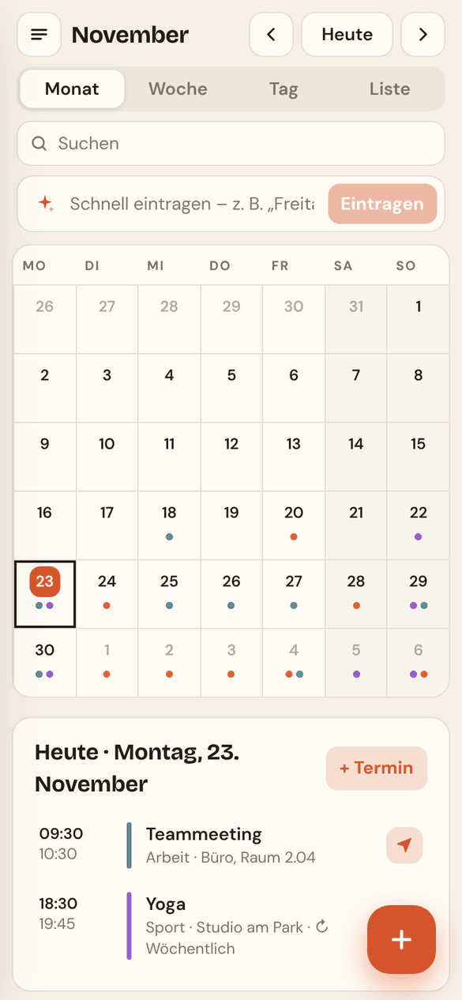
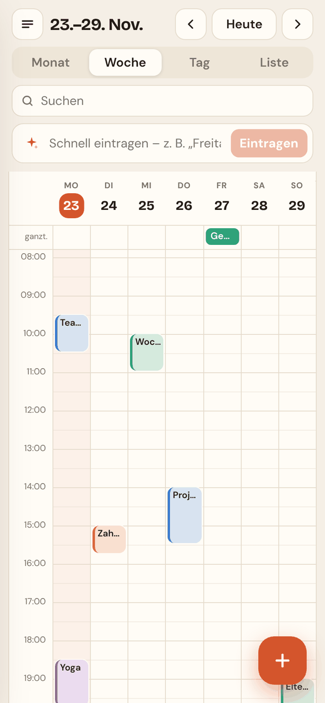
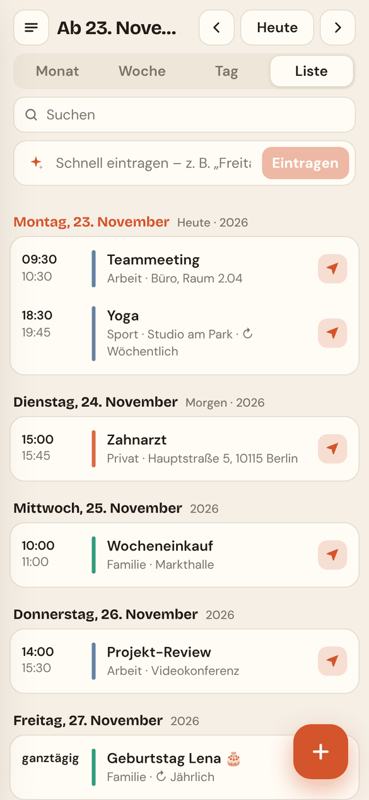
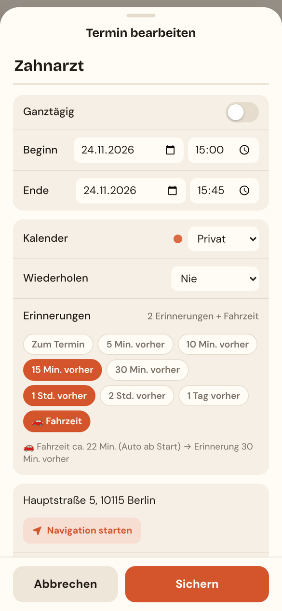
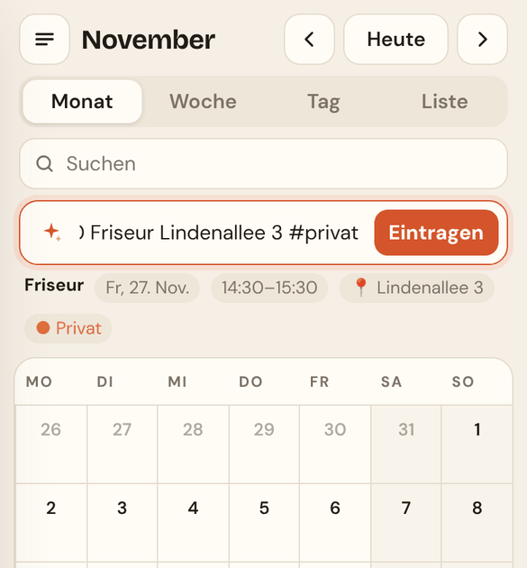
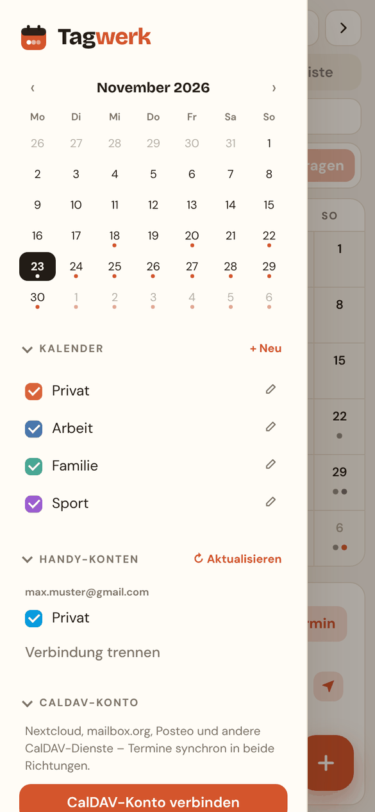
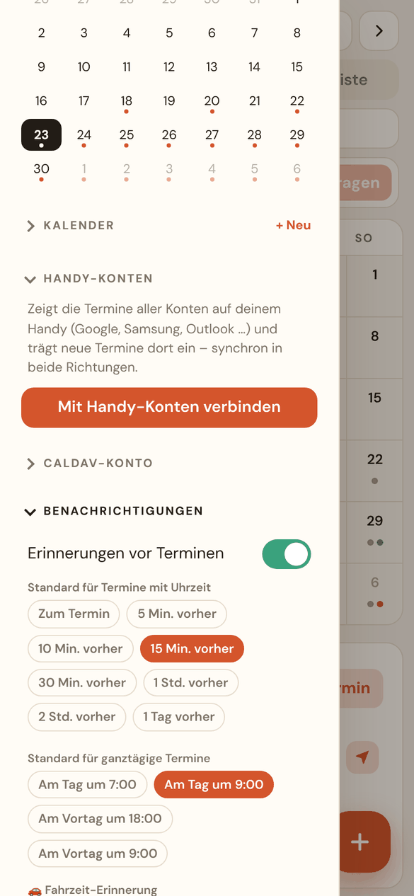
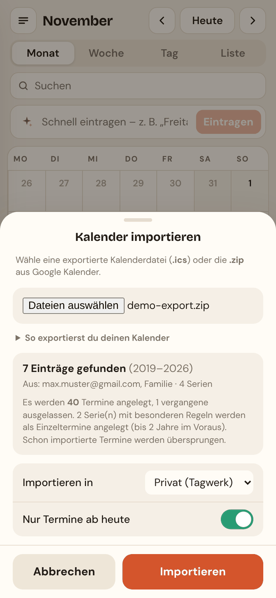
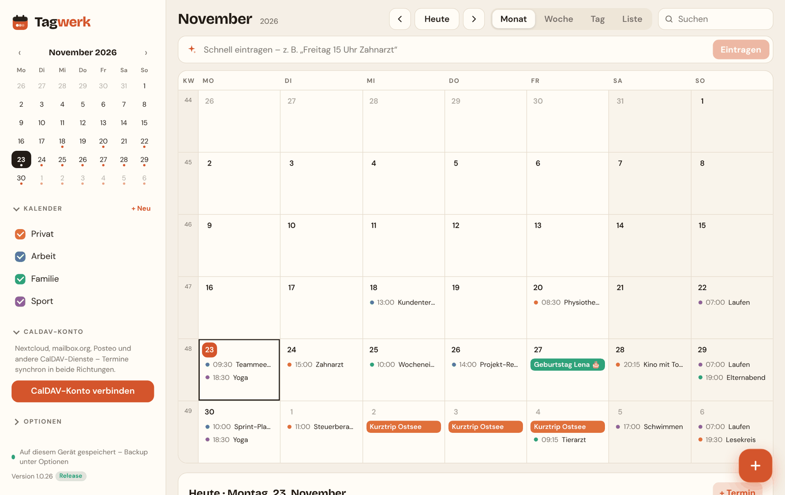

# Tagwerk – Kalender für Android und PC

Eigenständige Kalender-App mit eigenem Design.

## So sieht Tagwerk aus

| Monat | Woche | Liste | Termin bearbeiten |
|:---:|:---:|:---:|:---:|
|  |  |  |  |
| Kalenderwochen, Punkte für Termine, Tagesliste darunter | Zeitraster mit allen Terminen der Woche | Nächste Wochen auf einen Blick, mit Navigation 🧭 | Erinnerungen per Mehrfachauswahl, 🚗 Fahrzeit, Knöpfe im Daumenbereich |

| Schnell eintragen | Seitenleiste & Konten | Benachrichtigungen | Import |
|:---:|:---:|:---:|:---:|
|  |  |  |  |
| „Freitag 14:30 Friseur Lindenallee 3 #privat“ wird automatisch erkannt | Kalender, Handy-Konten, CalDAV – ein- und ausklappbar | Standard-Erinnerungen, Tagesübersicht, Fahrzeit | .ics oder Google-ZIP mit Vorschau |

**PC-Version** (installierbare Web-App):



<sub>Die Screenshots zeigen erfundene Beispieltermine.</sub>

## Funktionen
- Monats-, Wochen-, Tages- und Listenansicht, Kalenderwochen, deutsche Feiertage
- **Schnell eintragen** in normaler Sprache, z. B. `Morgen 15 Uhr Zahnarzt Hauptstraße 5, 10115 Berlin`
- Adressen (Straße + Hausnummer, PLZ + Ort) werden erkannt
- **Navigation:** Tippen auf das Pfeil-Symbol öffnet die Route in Google Maps (auf Android zusätzlich „Andere Navi-App“, z. B. Waze oder OsmAnd)
- Wiederkehrende Termine, eigene Kalender mit Farben, Suche, dunkles Design
- **Handy-Konten (Android):** zeigt und bearbeitet die Termine aller Kalender-Konten auf dem Handy
  (Google, Samsung, Outlook/Exchange, CalDAV über DAVx⁵ …) – Synchronisation in beide Richtungen
  übernimmt Android. Vorhandene Tagwerk-Termine lassen sich in ein Konto übertragen.
- **Google-Konto (PC/Web):** Anmeldung mit Google, Google-Kalender anzeigen und Termine dort
  eintragen, bearbeiten, löschen. Benötigt eine OAuth-Client-ID (siehe unten).
- **CalDAV-Konto (Android & PC):** Nextcloud, mailbox.org, Posteo, Radicale u. a. – Kalender anzeigen,
  Termine anlegen, ändern, löschen (auch einzelne Termine einer Serie). Android spricht den Server direkt an;
  am PC muss der Server Zugriffe von `https://plange-dev.github.io` erlauben (Nextcloud: App *WebAppPassword*).
- **Benachrichtigungen (Android):** Erinnerung vor Terminen (Standard einstellbar, pro Termin änderbar)
  und eine Tagesübersicht am Morgen. Termine aus Handy-Konten erinnert die Kalender-App des Kontos.
- **Fahrzeit-Erinnerung (Android):** berechnet die Fahrzeit (Auto/Fahrrad/zu Fuß) vom Startpunkt zum Ort
  des Termins über OpenStreetMap, rundet auf volle 15 Min. auf und erinnert ans Losfahren.
- **Widget (Android):** „Tagwerk – Heute“ zeigt die heutigen Termine auf dem Startbildschirm.
- **Import:** Kalenderdateien (.ics) und Google-Export (.zip) aus Google, Outlook, Nextcloud, Apple u. a.
  in einen Tagwerk-Kalender oder ein verbundenes Konto – mit Serien, Ausnahmen und Erinnerungen,
  ohne Doppelte; nach CalDAV unverändert (verlustfrei).
- **Export:** Kalender als .ics-Datei für Google, Outlook, Apple, Nextcloud u. a. – auf Android teilen
  (Gmail, Drive, Nextcloud …) oder in „Download/Tagwerk“ speichern; oder direkt in ein Konto kopieren.
- Funktioniert offline; Tagwerk-eigene Termine bleiben auf dem Gerät, Backup über *Optionen*

## Plattformen
- **Android:** App (APK), Hauptplattform
- **PC:** Web-App in Chrome/Edge, installierbar
- **iOS:** wird nicht gezielt unterstützt oder getestet. Die Web-Version lässt sich in Safari öffnen,
  ohne Erinnerungen, Widget und Handy-Konten.

## Installieren

**Android:** Unter *Releases* die neueste `Tagwerk.apk` herunterladen und öffnen.
Android fragt einmalig, ob Apps aus dieser Quelle installiert werden dürfen.

**PC (Chrome/Edge):** Die GitHub-Pages-Seite öffnen und in der Adressleiste auf
„App installieren“ klicken. (Einmalig in den Repo-Einstellungen unter
*Settings → Pages → Source* „GitHub Actions“ auswählen.)

## Selbst bauen
```
npm ci
npx cap sync android
cd android && ./gradlew assembleDebug
```
Jeder Push auf `main` baut automatisch eine neue APK (GitHub Actions).

## Branches
- **`nightly`** – Standard-Branch für neue Funktionen. Jeder Push baut eine Test-APK
  (unter *Actions* → letzter Lauf → *Artifacts*), aber kein Release.
- **`main`** – stabile Version. Was hier landet, wird automatisch als Release mit
  `Tagwerk.apk` veröffentlicht. Neue Funktionen kommen per Pull Request von `nightly` nach `main`.

## Google-Anmeldung einrichten (PC/Web)
1. https://console.cloud.google.com → neues Projekt „Tagwerk“
2. *APIs & Dienste → Bibliothek* → **Google Calendar API** aktivieren
3. *Google Auth Platform* → Branding (App-Name, Support-E-Mail), Zielgruppe **Extern**,
   eigene Gmail-Adresse als **Testnutzer** eintragen
4. *Clients → Client erstellen* → Typ **Webanwendung**,
   autorisierte JavaScript-Quelle: `https://plange-dev.github.io`
5. Client-ID in `www/index.html` bei `GOOGLE_CLIENT_ID` eintragen
